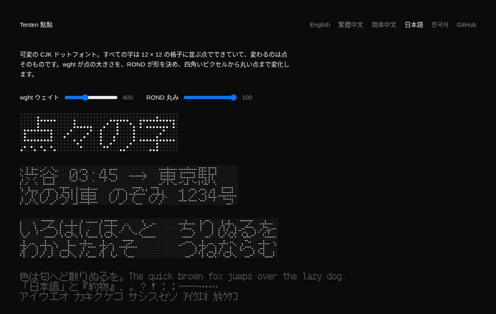

# Tenten 点々

[](https://github.com/linyiru/tenten/releases/latest) [](https://linyiru.github.io/tenten/ja/) [](#フォント) [](OFL.txt) [](LICENSE) [](Cargo.toml)

[English](README.md) · [繁體中文](README.zh-TW.md) · [简体中文](README.zh-CN.md) · **日本語** · [한국어](README.ko.md)

可変の CJK ドットフォント。すべての字は 12 × 12 の格子に並ぶ点でできていて、変わるのは点そのものです。`wght` が点の大きさを、`ROND` が形を決め、四角いピクセルから丸い点まで変化します。

*Tenten* は「点々（てんてん）」、点がひとつずつ並ぶさまです。中国語では「點點」と書き、意味も同じです。てんてんは濁点 ゛ の呼び名でもあります。着想は 5 × 7 のラテン文字ドットフォント [Punctum](https://github.com/sundyme/punctum) から。Tenten は同じ作り方を、漢字に必要な大きさで行います。

**見本：**[日本語](https://linyiru.github.io/tenten/ja/) · [繁體中文](https://linyiru.github.io/tenten/zh-TW/) · [简体中文](https://linyiru.github.io/tenten/zh-CN/) · [한국어](https://linyiru.github.io/tenten/ko/) · [English](https://linyiru.github.io/tenten/)



## フォント

ロケールごとに一書体、それぞれ Fusion Pixel Font の該当ロケールの字面から作っています。複数の言語で共通の字も、各言語の字形になります。

| フォント | ロケール | 文字集合 | 字数 | woff2 |
|---|---|---|---|---|
| `TentenTC-Big5` | 繁体字中国語 | ASCII、Big5 記号、Big5 常用漢字 5,401 字 | 5,845 | 126 KB |
| `TentenSC-GB2312` | 簡体字中国語 | GB 2312 | 7,368 | 142 KB |
| `TentenJP-JIS` | 日本語 | JIS X 0208 と JIS X 0201 のカナ | 7,010 | 144 KB |
| `TentenKR-KSX` | 韓国語 | KS X 1001 と現代ハングル音節 11,172 字すべて | 16,919 | 179 KB |
| `Tenten<L>-Full` | 上記それぞれ | 字面のすべての字 | 36,980 | — |

`.woff2` は [docs/fonts/](docs/fonts/) に、`.ttf`（フルセットを含む）は [Releases](https://github.com/linyiru/tenten/releases/latest) にあります。ファミリー名は `Tenten TC`、`Tenten SC`、`Tenten JP`、`Tenten KR` で、OS/2 のコードページと Unicode 範囲もそれぞれに合わせてあります。

軸と名前付きインスタンス：

| | `ROND` 100（丸） | `ROND` 0（角） |
|---|---|---|
| `wght` 100 | Thin | Pixel Thin |
| `wght` 400 | Regular | Pixel Regular |
| `wght` 900 | Black | Pixel Black |

元の字面になく、サブセットから抜けている字：

| フォント | 欠字 |
|---|---|
| TC | 記号 66 字（小書きの約物、数学記号、単位記号など）。漢字の欠けはなし。 |
| SC | まれな漢字 143 字（鼗赝劐衮脔…）と数学記号 31 字 |
| JP | 数学記号 33 字。かなと漢字の欠けはなし。 |
| KR | 漢字 36 字（磎恝旣擥笭…）と記号・単位記号 187 字。ハングルの欠けはなし。 |

## 作り方

字形のドットは [Fusion Pixel Font](https://github.com/TakWolf/fusion-pixel-font) 12px 等幅版（BDF、v2026.09.25）の zh_TW、zh_Hans、ja、ko の四字面から取っています。`tenten` は点灯している画素をひとつずつ、共有するひとつの点グリフへの参照に変えます。

- UPM 1200、格子 1 マスが 100 ユニット、アセンダー 1000、ディセンダー −200
- グリフ 1 が点そのもの：16 点の二次曲線の輪郭
- ほかのグリフはすべて点の参照からなる複合グリフで、点ひとつにつき 8 バイト
- `gvar` は点グリフの差分だけを持ち、フォント全体がひとつのグリフの五つの tuple で変化する
- 角のマスターは円を正方形へ放射状に投影したもので、二つの形は点ごとに補間される

```sh
scripts/fetch-source.sh   # 四つの BDF をダウンロードして検証し source/ へ
scripts/build-fonts.sh    # cargo build --release のあと build/*.ttf とサブセットの .woff2
cargo run --release --bin site   # docs/：見本サイト、ロケールごとに一ページ
```

`tenten [--locale TC|SC|JP|KR] <in.bdf> <out.ttf> [charset.txt]` で一書体を作ります。文字集合ファイルは UTF-8 で読み、含まれる字だけを残します。省くとすべての字を残します。`build-fonts.sh` は fontTools と brotli で `.woff2` を書き出します（python になければ `uvx` を使います）。`WOFF2_FULL=1` を指定するとフルセットも圧縮しますが、fontTools で一書体十分以上かかります。

`charsets/` の文字集合は Python の `big5`、`gb2312`、`euc_jp`、`euc_kr` コーデックから生成しました。Windows や GB 18030 が同じコードポイントを別の文字に対応づける場合は両方を残しています。たとえば GB 2312 の A1AA はコーデックでは U+2015、実際には U+2014 で、JIS の「～」は U+301C と U+FF5E のどちらでもあります。

`site` は見本サイトを `docs/` に書き出し、GitHub Pages で公開します。英語のトップページと、ロケールごとに独立したページがあり、それぞれ自分のフォントと `lang` で組まれます。書き出す前に、見本の字がすべてそのロケールのサブセットにあるかを確かめ、欠けていれば止まります。

## 映像

`film` は zh_TW の BDF から 20 秒の紹介映像を、絵も音も計算で作ります。フォント生成と同じく素の Rust で、ffmpeg はエンコードだけを担います。映像は [Releases](https://github.com/linyiru/tenten/releases/latest) にあります。

```sh
scripts/build-film.sh                  # build/film/tenten.mp4 と tenten.wav
scripts/build-film.sh --still 2,9.5,15 # 確認用の静止画だけ
```

- すべてのフレームは時刻だけの関数（`src/bin/film/scene.rs`）なので、並列に、どの順でも描けます。点の大きさと形は `tenten::dot_half`、つまりフォント自身のマスターから取るので、画面の点はその `wght` と `ROND` でフォントが描く点そのものです。
- 音楽（`audio.rs`）は、映像のタイミングを決めるのと同じイベント列から合成します。再生ヘッドが通る点灯した点がひとつの音になり、その行が D マイナー・ペンタトニックの音高を決め、`ROND` がパッドをサイン波から矩形波へ変えます。
- ラスタライザー（`raster.rs`）はアンチエイリアスのかかった角丸の四角とブルームを描き、速いカメラの動きは半フレームのシャッターで平均します。

## ライセンス

- **フォント**（`tenten` が `build/` に書き出すものすべてと `docs/fonts/`）：SIL Open Font License 1.1、[OFL.txt](OFL.txt) を参照。Fusion Pixel Font の改変版で、Ark Pixel Font、Cubic 11、Galmuri の字形を含みます。それぞれのライセンスは [LICENSES/](LICENSES/) にあります。
- **このリポジトリのそれ以外すべて**（Rust のソース、スクリプト、文字集合リスト、見本サイト）：MIT、[LICENSE](LICENSE) を参照。
