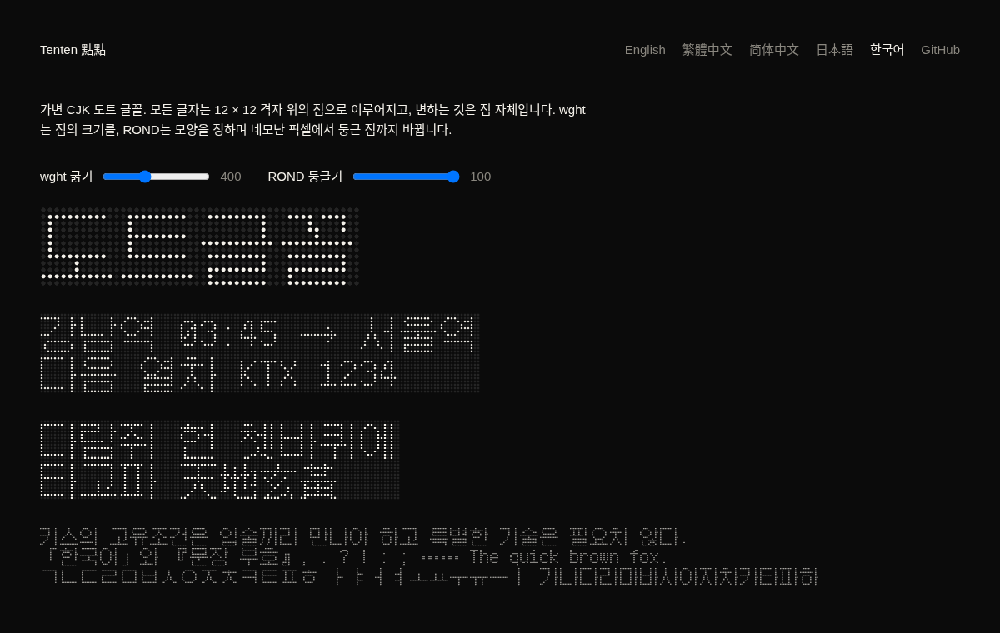

# Tenten 점점

[](https://github.com/linyiru/tenten/releases/latest) [](https://linyiru.github.io/tenten/ko/) [](#글꼴) [](OFL.txt) [](LICENSE) [](Cargo.toml)

[English](README.md) · [繁體中文](README.zh-TW.md) · [简体中文](README.zh-CN.md) · [日本語](README.ja.md) · **한국어**

가변 CJK 도트 글꼴. 모든 글자는 12 × 12 격자 위의 점으로 이루어지고, 변하는 것은 점 자체입니다. `wght`는 점의 크기를, `ROND`는 모양을 정하며 네모난 픽셀에서 둥근 점까지 바뀝니다.

*Tenten*은 일본어 点々(てんてん, 텐텐)으로, 점 하나하나라는 뜻입니다. 중국어로는 點點이라 쓰고 뜻도 같으며, てんてん은 탁점 ゛을 부르는 이름이기도 합니다. 5 × 7 라틴 도트 글꼴 [Punctum](https://github.com/sundyme/punctum)에서 착안했고, Tenten은 같은 방식을 한자에 필요한 크기로 만듭니다.

**견본:** [한국어](https://linyiru.github.io/tenten/ko/) · [繁體中文](https://linyiru.github.io/tenten/zh-TW/) · [简体中文](https://linyiru.github.io/tenten/zh-CN/) · [日本語](https://linyiru.github.io/tenten/ja/) · [English](https://linyiru.github.io/tenten/)



## 글꼴

로케일마다 글꼴이 하나씩 있고, 각각 Fusion Pixel Font의 해당 로케일 글자면에서 만들었습니다. 여러 언어가 함께 쓰는 글자도 언어마다 그 지역의 자형을 따릅니다.

| 글꼴 | 로케일 | 문자 집합 | 글리프 수 | woff2 |
|---|---|---|---|---|
| `TentenTC-Big5` | 중국어 번체 | ASCII, Big5 기호, Big5 상용 한자 5,401자 | 5,845 | 126 KB |
| `TentenSC-GB2312` | 중국어 간체 | GB 2312 | 7,368 | 142 KB |
| `TentenJP-JIS` | 일본어 | JIS X 0208과 JIS X 0201 가나 | 7,010 | 144 KB |
| `TentenKR-KSX` | 한국어 | KS X 1001과 현대 한글 음절 11,172자 전체 | 16,919 | 179 KB |
| `Tenten<L>-Full` | 위 각 로케일 | 글자면의 모든 글리프 | 36,980 | — |

`.woff2`는 [docs/fonts/](docs/fonts/)에, `.ttf`(전체 글꼴 포함)는 [Releases](https://github.com/linyiru/tenten/releases/latest)에 있습니다. 패밀리 이름은 `Tenten TC`, `Tenten SC`, `Tenten JP`, `Tenten KR`이며, OS/2 코드 페이지와 유니코드 범위도 각각 맞춰 두었습니다.

축과 이름 붙은 인스턴스:

| | `ROND` 100 (둥근) | `ROND` 0 (네모) |
|---|---|---|
| `wght` 100 | Thin | Pixel Thin |
| `wght` 400 | Regular | Pixel Regular |
| `wght` 900 | Black | Pixel Black |

원본 글자면에 없어서 서브셋에서 빠진 글자:

| 글꼴 | 빠진 글자 |
|---|---|
| TC | 기호 66자 (작은 문장 부호, 수학 기호, 단위 기호 등). 한자는 빠짐없음. |
| SC | 드문 한자 143자 (鼗赝劐衮脔…)와 수학 기호 31자 |
| JP | 수학 기호 33자. 가나와 한자는 빠짐없음. |
| KR | 한자 36자 (磎恝旣擥笭…)와 기호·단위 기호 187자. 한글은 빠짐없음. |

## 만드는 방법

글자의 점은 [Fusion Pixel Font](https://github.com/TakWolf/fusion-pixel-font) 12px 고정폭(BDF, v2026.09.25)의 zh_TW, zh_Hans, ja, ko 네 글자면에서 가져옵니다. `tenten`은 켜진 픽셀 하나하나를 공유하는 점 글리프 하나에 대한 참조로 바꿉니다.

- UPM 1200, 격자 한 칸이 100 유닛, 어센더 1000, 디센더 −200
- 글리프 1이 바로 그 점: 16개 점으로 된 2차 곡선 윤곽
- 나머지 글리프는 모두 점 참조로 이루어진 복합 글리프이고, 점 하나에 8바이트
- `gvar`는 점 글리프의 차분만 가지므로, 글꼴 전체가 글리프 하나의 튜플 다섯 개로 변함
- 네모 마스터는 원을 정사각형에 방사형으로 투영한 것이어서, 두 모양이 점 대 점으로 보간됨

```sh
scripts/fetch-source.sh   # BDF 네 개를 내려받아 검증하고 source/에 풂
scripts/build-fonts.sh    # cargo build --release 후 build/*.ttf와 서브셋 .woff2
cargo run --release --bin site   # docs/: 견본 사이트, 로케일마다 한 페이지
```

`tenten [--locale TC|SC|JP|KR] <in.bdf> <out.ttf> [charset.txt]`로 글꼴 하나를 만듭니다. 문자 집합 파일은 UTF-8로 읽어 그 안의 글자만 남기고, 생략하면 모든 글리프를 남깁니다. `build-fonts.sh`는 fontTools와 brotli로 `.woff2`를 씁니다(python에 없으면 `uvx`를 씁니다). `WOFF2_FULL=1`을 주면 전체 글꼴도 압축하는데, fontTools로 글꼴마다 10분 넘게 걸립니다.

`charsets/`의 문자 집합은 Python의 `big5`, `gb2312`, `euc_jp`, `euc_kr` 코덱으로 생성했습니다. Windows나 GB 18030이 같은 코드 포인트를 다른 문자에 대응시키는 경우 둘 다 남겼습니다. 예를 들어 GB 2312의 A1AA는 코덱에서는 U+2015, 실제로는 U+2014이고, JIS의 ～는 U+301C이기도 U+FF5E이기도 합니다.

`site`는 견본 사이트를 `docs/`에 쓰고, GitHub Pages가 이를 공개합니다. 영어 첫 페이지와 로케일마다 독립된 페이지가 있으며, 각각 자기 글꼴과 `lang`으로 짜입니다. 쓰기 전에 견본의 모든 글자가 그 로케일의 서브셋에 있는지 확인하고, 없으면 멈춥니다.

## 영상

`film`은 zh_TW BDF로 20초짜리 소개 영상을 그림과 소리 모두 계산해서 만듭니다. 글꼴 생성기와 마찬가지로 순수 Rust이고, ffmpeg는 인코딩만 맡습니다. 영상은 [Releases](https://github.com/linyiru/tenten/releases/latest)에 있습니다.

```sh
scripts/build-film.sh                  # build/film/tenten.mp4와 tenten.wav
scripts/build-film.sh --still 2,9.5,15 # 확인용 정지 화면만
```

- 모든 프레임은 시간만의 함수(`src/bin/film/scene.rs`)여서 병렬로, 어떤 순서로든 렌더링할 수 있습니다. 점의 크기와 모양은 글꼴 자신의 마스터인 `tenten::dot_half`에서 오므로, 화면의 점은 그 `wght`와 `ROND`에서 글꼴이 그리는 점과 같습니다.
- 음악(`audio.rs`)은 화면의 타이밍을 정하는 바로 그 이벤트 목록으로 합성합니다. 재생 헤드가 지나가는 켜진 점 하나가 음 하나이고, 그 행이 D 단조 5음 음계의 음높이를 정하며, `ROND`가 패드를 사인파에서 사각파로 바꿉니다.
- 래스터라이저(`raster.rs`)는 안티에일리어싱된 둥근 사각형과 블룸을 그리고, 빠른 카메라 움직임은 반 프레임 셔터로 평균합니다.

## 라이선스

- **글꼴**(`tenten`이 `build/`에 쓰는 모든 것과 `docs/fonts/`): SIL Open Font License 1.1, [OFL.txt](OFL.txt) 참고. Fusion Pixel Font의 수정 버전이며 Ark Pixel Font, Cubic 11, Galmuri의 글리프를 포함합니다. 각 라이선스는 [LICENSES/](LICENSES/)에 있습니다.
- **이 저장소의 나머지 모두**(Rust 소스, 스크립트, 문자 집합 목록, 견본 사이트): MIT, [LICENSE](LICENSE) 참고.
