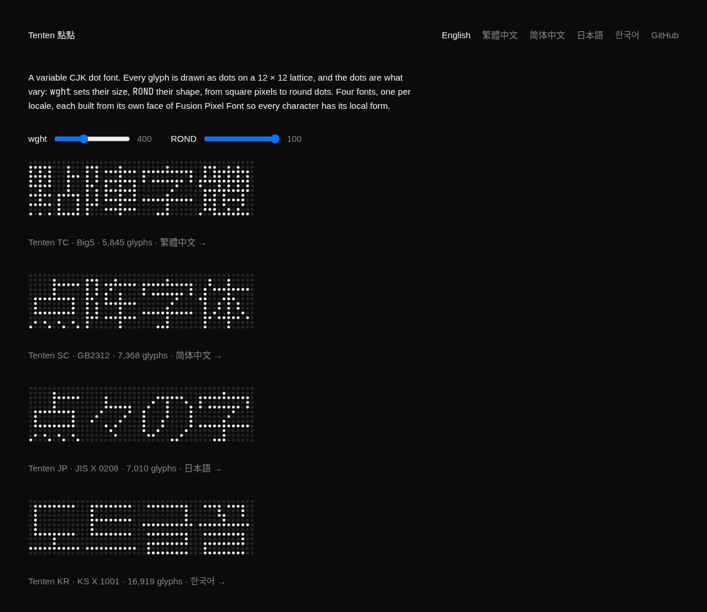

# Tenten 點點

A variable CJK dot font. Every glyph is drawn as dots on a 12 × 12 lattice,
and the dots are what vary: `wght` sets their size, `ROND` their shape, from
square pixels to round dots.

*Tenten* is 点々 (*ten-ten*), Japanese for "dot by dot". It is written 點點 in
Chinese with the same meaning, and てんてん is also the everyday name of the
two-dot mark ゛. The idea comes from
[Punctum](https://github.com/sundyme/punctum), a 5 × 7 Latin dot font. Tenten
uses the same construction at the size Han characters need.



## Fonts

| file | glyphs | size |
|---|---|---|
| `TentenTC-Big5.ttf` / `.woff2` | 5,839: ASCII, Big5 symbols, and the 5,401 common Big5 hanzi | 2.7 MB / about 128 KB |
| `TentenTC-Full.ttf` | 36,980: every glyph in the source | 16.5 MB |

Axes and named instances:

| | `ROND` 100 (round) | `ROND` 0 (square) |
|---|---|---|
| `wght` 100 | Thin | Pixel Thin |
| `wght` 400 | Regular | Pixel Regular |
| `wght` 900 | Black | Pixel Black |

## How it is built

Glyph bitmaps come from the zh_TW face of
[Fusion Pixel Font](https://github.com/TakWolf/fusion-pixel-font) 12px
monospaced (BDF, v2026.09.25). `tenten` turns each lit pixel into a reference
to one shared dot glyph:

- UPM 1200, one lattice cell is 100 units, ascender 1000, descender −200
- glyph 1 is the dot: a 16-point quadratic contour
- every other glyph is a composite of dot references, 8 bytes per dot
- `gvar` holds deltas only for the dot glyph, so the whole font varies through one glyph's five tuples
- the square masters are the circle projected radially onto a square, so the two shapes interpolate point for point

```sh
scripts/fetch-source.sh   # download and verify the BDF into source/
scripts/build-fonts.sh    # cargo build --release, then build/*.ttf and the Big5 .woff2
```

`tenten <in.bdf> <out.ttf> [charset.txt]` builds one font. The charset file
keeps the characters it contains, read as UTF-8, and leaving it out keeps every
glyph. `build-fonts.sh` writes `.woff2` when `fontTools` and `brotli` can be
imported; set `WOFF2_FULL=1` to compress the full font as well, which takes
fontTools over ten minutes.

`charsets/big5-common.txt` was generated from Python's `big5` codec. Of its
symbols, 61 are not in the source and are skipped. No hanzi are missing.

`site/index.html` is a specimen page with sliders for both axes. It reads
`build/TentenTC-Big5.woff2`.

## Film

`film` renders a 20-second launch film, picture and sound, from the same
BDF. It is plain Rust like the font builder; ffmpeg only encodes.

```sh
scripts/build-film.sh                  # build/film/tenten.mp4 and tenten.wav
scripts/build-film.sh --still 2,9.5,15 # review stills only
```

- Every frame is a pure function of time (`src/bin/film/scene.rs`), so frames
  render in parallel and in any order. A dot's size and shape come from
  `tenten::dot_half`, the font's own masters, so a dot on screen is the dot
  the font draws at that `wght` and `ROND`.
- The score (`audio.rs`) is synthesized from the event list the picture is
  timed by: each lit dot the playhead passes is a note, its row the pitch on
  a D minor pentatonic, and `ROND` turns the pad from sine to square.
- The rasterizer (`raster.rs`) draws anti-aliased rounded squares with a
  bloom, and fast camera moves are averaged over a half-frame shutter.

## License

- **Fonts** (everything `tenten` writes into `build/`): SIL Open Font License
  1.1, see [OFL.txt](OFL.txt). They are a Modified Version of Fusion Pixel
  Font, which includes glyphs from Ark Pixel Font, Cubic 11, and Galmuri. Their
  licenses are in [LICENSES/](LICENSES/).
- **Everything else in this repository** (the Rust source, scripts, charset
  list, and specimen page): MIT, see [LICENSE](LICENSE).
