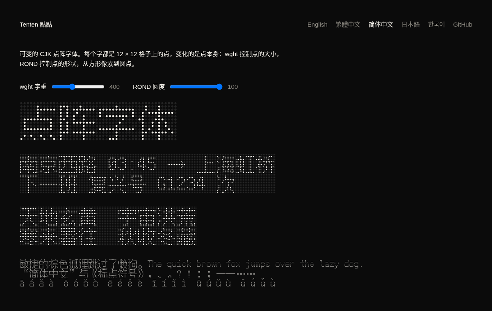

# Tenten 点点

[](https://github.com/linyiru/tenten/releases/latest) [](https://linyiru.github.io/tenten/zh-CN/) [](#字体) [](OFL.txt) [](LICENSE) [](Cargo.toml)

[English](README.md) · [繁體中文](README.zh-TW.md) · **简体中文** · [日本語](README.ja.md) · [한국어](README.ko.md)

可变的 CJK 点阵字体。每个字都是 12 × 12 格子上的点，变化的是点本身：`wght` 控制点的大小，`ROND` 控制点的形状，从方形像素到圆点。

*Tenten* 是日语的“点々”（てんてん），意思是一点一点，中文写作“点点”；てんてん也是浊音符号 ゛ 的俗称。构想来自 5 × 7 的拉丁点阵字体 [Punctum](https://github.com/sundyme/punctum)，Tenten 用同样的做法，做到汉字需要的大小。

**样张：**[简体中文](https://linyiru.github.io/tenten/zh-CN/) · [繁體中文](https://linyiru.github.io/tenten/zh-TW/) · [日本語](https://linyiru.github.io/tenten/ja/) · [한국어](https://linyiru.github.io/tenten/ko/) · [English](https://linyiru.github.io/tenten/)



## 字体

每个语言区域一套字体，各自取自 Fusion Pixel Font 对应的字面，所以同一个字在不同语言里是当地的写法。

| 字体 | 语言 | 字符集 | 字符数 | woff2 |
|---|---|---|---|---|
| `TentenTC-Big5` | 繁体中文 | ASCII、Big5 符号、5,401 个 Big5 常用汉字 | 5,845 | 126 KB |
| `TentenSC-GB2312` | 简体中文 | GB 2312 | 7,368 | 142 KB |
| `TentenJP-JIS` | 日语 | JIS X 0208 与 JIS X 0201 假名 | 7,010 | 144 KB |
| `TentenKR-KSX` | 韩语 | KS X 1001 与全部 11,172 个现代韩文音节 | 16,919 | 179 KB |
| `Tenten<L>-Full` | 以上各语言 | 字面中的所有字符 | 36,980 | — |

`.woff2` 在 [docs/fonts/](docs/fonts/)；`.ttf`（含完整版）在 [Releases](https://github.com/linyiru/tenten/releases/latest)。字体家族名分别为 `Tenten TC`、`Tenten SC`、`Tenten JP`、`Tenten KR`，OS/2 的代码页与 Unicode 范围也各自对应。

轴与命名样式：

| | `ROND` 100（圆） | `ROND` 0（方） |
|---|---|---|
| `wght` 100 | Thin | Pixel Thin |
| `wght` 400 | Regular | Pixel Regular |
| `wght` 900 | Black | Pixel Black |

源字面没有、因而子集跳过的字：

| 字体 | 缺字 |
|---|---|
| TC | 66 个符号，多为小型标点、数学符号与单位字。汉字无缺。 |
| SC | 143 个生僻汉字（鼗赝劐衮脔…）与 31 个数学符号 |
| JP | 33 个数学符号。假名与汉字无缺。 |
| KR | 36 个韩国汉字（磎恝旣擥笭…）与 187 个符号、单位字。韩文无缺。 |

## 构建方式

字形点阵取自 [Fusion Pixel Font](https://github.com/TakWolf/fusion-pixel-font) 12px 等宽版（BDF，v2026.09.25）的 zh_TW、zh_Hans、ja、ko 四个字面。`tenten` 把每个亮着的像素变成对同一个点字形的引用：

- UPM 1200，一格 100 单位，上升 1000，下降 −200
- 1 号字形就是那个点：16 个点的二次曲线轮廓
- 其他字形都是由点引用组成的复合字形，每个点 8 字节
- `gvar` 只为点字形存储差值，整套字体靠一个字形的五组 tuple 变化
- 方形母版是把圆沿半径投影到正方形，两种形状逐点对应插值

```sh
scripts/fetch-source.sh   # 下载并校验四个 BDF 到 source/
scripts/build-fonts.sh    # cargo build --release，生成 build/*.ttf 与子集 .woff2
cargo run --release --bin site   # docs/：样张网站，每种语言一页
```

`tenten [--locale TC|SC|JP|KR] <in.bdf> <out.ttf> [charset.txt]` 生成一套字体。字符集文件按 UTF-8 读取，保留其中的字；不给字符集则保留全部字符。`build-fonts.sh` 通过 fontTools 与 brotli 生成 `.woff2`（用 python，没有就用 `uvx`）；设置 `WOFF2_FULL=1` 也会压缩完整版，fontTools 每套需要十分钟以上。

`charsets/` 中的字符集由 Python 的 `big5`、`gb2312`、`euc_jp`、`euc_kr` 编码生成。Windows 或 GB 18030 把同一码位映射到不同字符时，两者都保留：例如 GB 2312 的 A1AA 在编码器中是 U+2015，实际使用的是 U+2014；JIS 的“～”是 U+301C 或 U+FF5E。

`site` 把样张网站写到 `docs/`，由 GitHub Pages 发布：一个英文首页，加上每种语言各自独立的一页，各用自己的字体与 `lang`。写入前会检查每个示例字都在该语言的子集中，缺字即停止。

## 影片

`film` 从 zh_TW 的 BDF 计算出一支 20 秒的发布影片，画面与声音都是。它和字体生成器一样是纯 Rust，ffmpeg 只负责编码。影片在 [Releases](https://github.com/linyiru/tenten/releases/latest)。

```sh
scripts/build-film.sh                  # build/film/tenten.mp4 与 tenten.wav
scripts/build-film.sh --still 2,9.5,15 # 只输出检查用的静帧
```

- 每一帧都只是时间的函数（`src/bin/film/scene.rs`），所以可以并行、按任意顺序渲染。点的大小与形状来自 `tenten::dot_half`，即字体自己的母版，屏幕上的点就是字体在该 `wght` 与 `ROND` 下画出的点。
- 配乐（`audio.rs`）由画面计时所用的同一份事件表合成：播放头经过的每个亮点是一个音，所在行决定 D 小调五声音阶上的音高，`ROND` 让铺底从正弦波变成方波。
- 光栅器（`raster.rs`）绘制抗锯齿的圆角方块并加上辉光，快速运镜以半帧快门取平均。

## 许可

- **字体**（`tenten` 写入 `build/` 的所有文件，以及 `docs/fonts/`）：SIL Open Font License 1.1，见 [OFL.txt](OFL.txt)。它们是 Fusion Pixel Font 的修改版本，其中包含 Ark Pixel Font、Cubic 11 与 Galmuri 的字形，许可见 [LICENSES/](LICENSES/)。
- **本仓库其他所有内容**（Rust 源码、脚本、字符集表与样张网站）：MIT，见 [LICENSE](LICENSE)。
