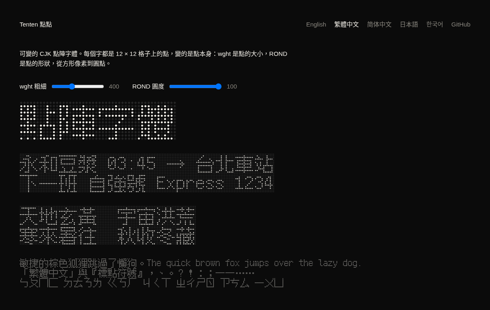

# Tenten 點點

[](https://github.com/linyiru/tenten/releases/latest) [](https://linyiru.github.io/tenten/zh-TW/) [](#字型) [](OFL.txt) [](LICENSE) [](Cargo.toml)

[English](README.md) · **繁體中文** · [简体中文](README.zh-CN.md) · [日本語](README.ja.md) · [한국어](README.ko.md)

可變的 CJK 點陣字體。每個字都是 12 × 12 格子上的點，變的是點本身：`wght` 是點的大小，`ROND` 是點的形狀，從方形像素到圓點。

*Tenten* 是日文的「点々」（てんてん），意思是一點一點，中文寫作「點點」；てんてん也是濁音符號 ゛ 的俗稱。構想來自 5 × 7 的拉丁點陣字體 [Punctum](https://github.com/sundyme/punctum)，Tenten 用同樣的做法，做到漢字需要的大小。

**樣張：**[繁體中文](https://linyiru.github.io/tenten/zh-TW/) · [简体中文](https://linyiru.github.io/tenten/zh-CN/) · [日本語](https://linyiru.github.io/tenten/ja/) · [한국어](https://linyiru.github.io/tenten/ko/) · [English](https://linyiru.github.io/tenten/)



## 字型

每個語系一套字型，各自取自 Fusion Pixel Font 對應語系的字面，所以同一個字在不同語言裡會是當地的寫法。

| 字型 | 語系 | 字集 | 字符數 | woff2 |
|---|---|---|---|---|
| `TentenTC-Big5` | 繁體中文 | ASCII、Big5 符號、5,401 個 Big5 常用漢字 | 5,845 | 126 KB |
| `TentenSC-GB2312` | 簡體中文 | GB 2312 | 7,368 | 142 KB |
| `TentenJP-JIS` | 日文 | JIS X 0208 與 JIS X 0201 假名 | 7,010 | 144 KB |
| `TentenKR-KSX` | 韓文 | KS X 1001 與全部 11,172 個現代韓文音節 | 16,919 | 179 KB |
| `Tenten<L>-Full` | 以上各語系 | 字面中的所有字符 | 36,980 | — |

`.woff2` 在 [docs/fonts/](docs/fonts/)；`.ttf`（含完整版）在 [Releases](https://github.com/linyiru/tenten/releases/latest)。字型家族名稱分別是 `Tenten TC`、`Tenten SC`、`Tenten JP`、`Tenten KR`，OS/2 的字碼頁與 Unicode 範圍也各自對應。

軸與具名樣式：

| | `ROND` 100（圓） | `ROND` 0（方） |
|---|---|---|
| `wght` 100 | Thin | Pixel Thin |
| `wght` 400 | Regular | Pixel Regular |
| `wght` 900 | Black | Pixel Black |

來源字面沒有、因此子集略過的字：

| 字型 | 缺字 |
|---|---|
| TC | 66 個符號，多為小型標點、數學符號與單位字。漢字無缺。 |
| SC | 143 個罕用漢字（鼗赝劐衮脔…）與 31 個數學符號 |
| JP | 33 個數學符號。假名與漢字無缺。 |
| KR | 36 個韓國漢字（磎恝旣擥笭…）與 187 個符號、單位字。韓文無缺。 |

## 製作方式

字形點陣取自 [Fusion Pixel Font](https://github.com/TakWolf/fusion-pixel-font) 12px 等寬版（BDF，v2026.09.25）的 zh_TW、zh_Hans、ja、ko 四個字面。`tenten` 把每個亮著的像素變成對同一個點字形的參照：

- UPM 1200，一格 100 單位，上緣 1000，下緣 −200
- 1 號字形就是那個點：16 個點的二次曲線輪廓
- 其他字形都是點參照組成的複合字形，每個點 8 位元組
- `gvar` 只為點字形存差值，整套字型靠一個字形的五組 tuple 變化
- 方形主板是把圓沿半徑投影到正方形，兩種形狀逐點對應內插

```sh
scripts/fetch-source.sh   # 下載並驗證四個 BDF 到 source/
scripts/build-fonts.sh    # cargo build --release，產生 build/*.ttf 與子集 .woff2
cargo run --release --bin site   # docs/：樣張網站，每個語系一頁
```

`tenten [--locale TC|SC|JP|KR] <in.bdf> <out.ttf> [charset.txt]` 產生一套字型。字集檔以 UTF-8 讀取，保留其中的字；不給字集就保留全部字符。`build-fonts.sh` 透過 fontTools 與 brotli 產生 `.woff2`（用 python，沒有就用 `uvx`）；設 `WOFF2_FULL=1` 也會壓縮完整版，fontTools 每套要十分鐘以上。

`charsets/` 的字集由 Python 的 `big5`、`gb2312`、`euc_jp`、`euc_kr` 編碼產生。Windows 或 GB 18030 把同一碼位對應到不同字元時，兩者都保留：例如 GB 2312 的 A1AA 在編碼器裡是 U+2015，實際使用是 U+2014；JIS 的「～」是 U+301C 或 U+FF5E。

`site` 把樣張網站寫到 `docs/`，由 GitHub Pages 發布：一頁英文首頁，加上每個語系各自獨立的一頁，各用自己的字型與 `lang`。寫入前會檢查每個範例字都在該語系的子集裡，缺字就停止。

## 影片

`film` 從 zh_TW 的 BDF 算出一支 20 秒的發表影片，畫面與聲音都是。它和字型產生器一樣是純 Rust，ffmpeg 只負責編碼。影片在 [Releases](https://github.com/linyiru/tenten/releases/latest)。

```sh
scripts/build-film.sh                  # build/film/tenten.mp4 與 tenten.wav
scripts/build-film.sh --still 2,9.5,15 # 只輸出檢查用的靜態畫面
```

- 每一格畫面都只是時間的函數（`src/bin/film/scene.rs`），所以可以平行、任意順序算圖。點的大小與形狀來自 `tenten::dot_half`，也就是字型自己的主板，畫面上的點就是字型在那個 `wght` 與 `ROND` 畫出的點。
- 配樂（`audio.rs`）由畫面計時用的同一份事件表合成：播放頭經過的每個亮點是一個音，所在列決定 D 小調五聲音階上的音高，`ROND` 讓襯底從正弦波變成方波。
- 點陣算圖器（`raster.rs`）畫反鋸齒的圓角方塊並加上光暈，快速運鏡以半格快門取平均。

## 授權

- **字型**（`tenten` 寫到 `build/` 的一切，以及 `docs/fonts/`）：SIL Open Font License 1.1，見 [OFL.txt](OFL.txt)。它們是 Fusion Pixel Font 的修改版本，其中包含 Ark Pixel Font、Cubic 11（俐方體11號）與 Galmuri 的字形，授權見 [LICENSES/](LICENSES/)。
- **本 repository 其他所有內容**（Rust 原始碼、腳本、字集表與樣張網站）：MIT，見 [LICENSE](LICENSE)。
